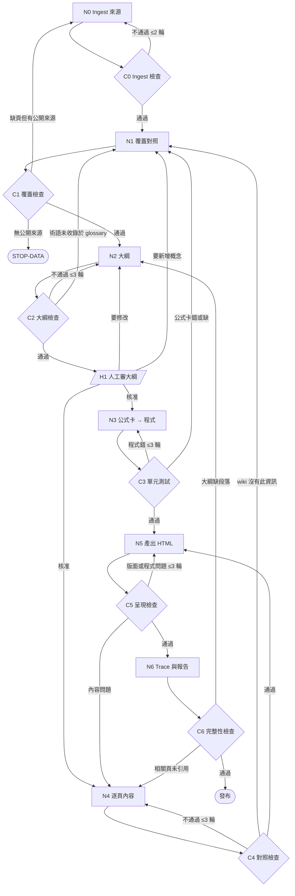

# GRAPH_SPEC.md — Derivatives Lab 教學簡報生成流程

> **用途**：本檔是 AI agent 的執行規格。agent 每次開始工作前，必須先讀 `AGENTS.md`（Wiki 規則）與本檔（簡報生成流程），並嚴格依照本檔的節點、通過條件、跳轉與停止規則執行。
> **原則**：只修檢查報告列出的問題；不得自行新增功能、概念、互動工具或改變架構；遇到規格未涵蓋的情況一律停止並回報。

## 版本紀錄

| 版本 | 日期 | 改了什麼 | 為什麼 |
|---|---|---|---|
| v1 | 2026-11-18 定案；2026-11-19 增補 | run v1 使用的規格。run v1 期間依 Itzel 裁示增補三處：C3 數值容差、C4 為字數改寫同頁文字的例外、§9 Bloomberg 條款的說明 | 增補原因見 `runs/v1/C3_report.md`、`runs/v1/C4_report.md` 與 `docs/agents-md-decisions.md` §7、§9 |
| **v2** | 2026-11-19 | ① **術語檢查往前移到 C2**：N2 的輸出加上「術語首次出現表」；C2 新增 **C2-7**（大綱用到的專門術語都已收錄在 `glossary.md`，且首次出現的那一頁安排了定義）；graph 新增 **C2 → N1** 跳轉（glossary 缺漏回 N1 補）。C4-5 保留，用來量測往前移之後還漏掉多少<br>② **字數檢查往前移到 C4**：C4 新增 **C4-7**（在 `slides.md` 上計算每頁主文 ≤ 120 字、≤ 5 點）；C5-3 保留，作為成品的最終確認<br>③ §8 寫明 v2 的公平比較做法：wiki 還原到 v1 起點（commit `75a35ef`）、沿用 v1 核准的大綱內容、使用相同的檢查工具與計數規則 | 依 `runs/v1/check_report.md` 與各檢查報告：<br>• v1 最多的錯誤是 **E8 術語未定義（13／25）**，全部在 C4 才被抓到；其中 10 個源自 N0 的 glossary 缺漏（術語早已出現在 wiki 頁，卻沒有收錄），9 個在 H1 核准的大綱中就已出現。v0 最多的也是 E8（23）<br>• C4 的修正受 C5-3 字數上限牽制，但字數要到 C5 才檢查，造成 v1 唯一一次 STOP-REGRESSION（C4-v1-r2-01）與 4 處未列出的改寫 |
| **v2.1** | 2026-11-20 | 檢查規則與 graph **都不變**。只換呈現：`style.md` 改為 v2（藍金配色、明暗交替、6 種頁型、3D 封面），以 v2 的成品為輸入，**只重跑 N5 → C5 → N6 → C6**（做法見 §8「v2.1 的做法」） | v2 完成後 Itzel 認為簡報版面單調、封面曲面太小；原因是 `style.md` v1 只用一張 S03 範例頁核准，看不出 19 頁的整體節奏。改版經過見 `style.md` 檔首版本紀錄與 `docs/agents-md-decisions.md` §11 |

---

## 0. 專案目標

| 項目 | 內容 |
|---|---|
| 主標 | **Derivatives Lab｜波動率為什麼不是一個數字？** |
| 副標 | 從一張選擇權，到一張結構型商品的定價實驗室 |
| 核心教學問題 | 如果 Black-Scholes 是對的，同一標的所有選擇權反推出的波動率應該都一樣。為什麼市場上卻是一張彎曲的曲面？這張曲面又如何影響結構型商品？ |
| 目標讀者 | 沒學過衍生性商品的大學生／一般投資人 |
| 深度設計 | 每個概念三層：① 直覺（白話＋圖）② 公式（可摺疊「進階」區塊，LaTeX）③ 動手（互動工具） |
| 產出 | `slides/index.html`（可在 GitHub Pages 瀏覽）、`trace.md`、`runs/<run-id>/check_report.md` |

### 學習目標（每頁、每題測驗都必須對應其中之一）

- **L1**：看懂選擇權的履約價 K、到期日 T 與損益圖
- **L2**：說出「隱含波動率」是從市場價格反推出來的
- **L3**：解釋波動率曲面為什麼不是平的（skew、期限結構）
- **L4**：說明簡化 ELN 的票息從哪裡來、投資人承擔什麼風險

---

## 1. 資料夾結構

```
derivatives-lab/
├── AGENTS.md                 # Wiki 規則（ingest、命名、出處格式）
├── GRAPH_SPEC.md             # 本檔
├── style.md                  # 簡報視覺規格（事前選定，N5 必須遵守）
├── docs/                     # 決策紀錄（agents-md-decisions.md）
├── raw/                      # 原始來源（PDF / HTML 存檔），不得修改
│   └── MANIFEST.md           # 所有來源的 URL、取得日、SHA-256、是否 commit
├── wiki/
│   ├── index.md              # 所有 wiki 頁清單＋一句話摘要
│   ├── log.md                # ingest 與修改紀錄（時間、來源、變更頁）
│   ├── glossary.md           # 術語表（中英對照＋定義＋出處）
│   ├── sources/              # 每份來源一頁
│   ├── concepts/             # 概念頁
│   ├── products/             # 商品頁
│   └── risks/                # 風險與常見誤解
├── lab/                      # 互動工具程式（由 N3 產生）
│   ├── bs.js  iv.js  svi.js  eln.js
│   └── tests/                # C3 單元測試
├── slides/
│   ├── outline.md            # N2 產出
│   ├── slides.md             # N4 產出（逐頁內容）
│   ├── assets/               # 簡報圖片（相對路徑引用）
│   └── index.html            # N5 產出
├── trace.md                  # N6 產出：投影片 → wiki 頁 → 原始來源
├── tools/                    # Wiki 檢查腳本（引文比對、lint、公式卡數值預檢）；不是 C3
└── runs/
    ├── pre-run/              # 不屬於任何 run 的 ingest 與 lint 報告
    └── <run-id>/             # 每次執行一個資料夾，例如 v0-baseline、v1、v2
        ├── C0_report.md … C6_report.md
        └── check_report.md   # 本次執行總表
```

---

## 2. Wiki 規格

### 2.1 主張類型標籤（每條關鍵主張都要標）

| 標籤 | 意義 | 要求 |
|---|---|---|
| `[事實]` | 來源原文陳述的事實 | 附來源 ID＋頁碼／章節 |
| `[範例]` | 來源中的數字範例 | 附來源 ID＋頁碼；數字逐字照抄 |
| `[觀點]` | 作者或機構的看法 | 附來源 ID；簡報中須寫明「某某認為」 |
| `[推導]` | 自行推導（非來源原文） | 附完整推導步驟，且必須有對應的 C3 程式測試 |

出處格式：`（S5, p.3）` 或 `（S4, §2）`。

### 2.2 公式卡

所有公式寫成公式卡，每張有唯一 ID，`lab/` 程式中的每個函式都必須以註解標出對應的公式 ID。

```
> **F03｜Black-Scholes call price**
> $$C = S N(d_1) - K e^{-rT} N(d_2)$$
> 符號定義：…
> 適用假設：歐式、無股利、常數波動率與利率
> 出處：（S3, p.xx）
```

公式卡目前編到 F17，總表見 `wiki/index.md` 的公式卡欄。F01–F09 的內容由本檔 §2.4、§2.5 指定；F10 起依 `AGENTS.md` §4.3 依序編號。

### 2.3 來源清單（至少 5 份，目標 13 份）

| ID | 來源 | 主要支撐 | 取得位置 |
|---|---|---|---|
| S1 | OCC, *Characteristics and Risks of Standardized Options* | L1 選擇權基本定義與風險 | https://www.theocc.com/components/docs/riskstoc.pdf |
| S2 | Cboe, *VIX White Paper / Methodology* | L2 隱含波動率的實際應用 | https://cdn.cboe.com/resources/vix/VIX_Methodology.pdf |
| S3 | Derman, *An Introduction to the Volatility Smile*（港中文 2013 短期課程；實際只有 3 頁課程目標與大綱，沒有講義本文） | 一句作者觀點（模型假設都不是真的成立）；原訂的 L2–L3 內容改由 S10–S13 支撐 | https://www.cfe.cuhk.edu.hk/?p=4264 |
| S4 | Gatheral & Jacquier (2012), *Arbitrage-free SVI volatility surfaces* | L3 曲面參數化、無套利 | https://arxiv.org/pdf/1204.0646 |
| S5 | OCC / OIC, *Understanding the Greeks*（教學投影片） | Vega 定義（其他 Greeks 為延伸） | https://fidelity.com/bin-public/060_www_fidelity_com/documents/learning-center/understanding-greeks-OIC-slides.pdf |
| S6 | SEC, *Investor Bulletin: Structured Notes* | L4 債券＋內嵌衍生性商品、風險 | https://investor.gov/additional-resources/news-alerts/alerts-bulletins/investor-bulletin-structured-notes |
| S7 | FINRA / SEC, 保本型結構型商品投資人警示 | L4 保本的信用風險、隱藏成本 | https://www.investor.gov/introduction-investing/general-resources/news-alerts/alerts-bulletins/investor-bulletins/structured |
| S8 | Barclays Bank PLC, *Phoenix AutoCallable Notes due December 12, 2018*（SEC EDGAR 424B2 pricing supplement, 2015-12-07） | L4 估計價值低於發行價 | https://www.sec.gov/Archives/edgar/data/312070/000119312515398608/d101037d424b2.htm |
| S9 | 洪綾襄，〈從美超微下市風波 看懂結構型商品的高息陷阱〉（引自《財訊》雙週刊，Yahoo 股市，2024-11-29） | L4 台灣真實案例（ELN ≈ 賣出 put） | https://tw.stock.yahoo.com/news/%E5%BE%9E%E7%BE%8E%E8%B6%85%E5%BE%AE%E4%B8%8B%E5%B8%82%E9%A2%A8%E6%B3%A2-%E7%9C%8B%E6%87%82%E7%B5%90%E6%A7%8B%E5%9E%8B%E5%95%86%E5%93%81%E7%9A%84%E9%AB%98%E6%81%AF%E9%99%B7%E9%98%B1-020101153.html |
| S10 | Derman (2003), *Laughter in the Dark — The Problem of the Volatility Smile* | L3 BS 下曲面應為平的、1987 年後的 skew、成因 | https://emanuelderman.com/wp-content/uploads/2003/04/Amsterdam.pdf |
| S11 | Derman & Kani (1994), *The Volatility Smile and Its Implied Tree*（Goldman Sachs Quantitative Strategies Research Notes） | L2–L3 隱含波動率定義、skew 與期限結構定義、常數波動率假設 | https://emanuelderman.com/wp-content/uploads/1994/01/gs-volatility_smile.pdf |
| S12 | MIT OpenCourseWare 18.S096 (Fall 2013) Lecture 19, Strela, *Black-Scholes Formula & Risk-neutral Valuation* | L2 BS 公式 F03–F05 | https://ocw.mit.edu/courses/18-s096-topics-in-mathematics-with-applications-in-finance-fall-2013/resources/mit18_s096f13_lecnote19/ |
| S13 | MIT OpenCourseWare 18.440 (Spring 2014) Lecture 36, Sheffield, *Risk Neutral Probability and Black-Scholes* | L2–L3 隱含波動率的白話定義、BS 若正確則各履約價 IV 相同 | https://ocw.mit.edu/courses/18-440-probability-and-random-variables-spring-2014/4583e12e3e052256867388dd86eb5b8b_MIT18_440S14_Lecture36.pdf |

> S10–S13 於 2026-11-18 經 Itzel 核准加入，原因是 S3 指定網址只有課程大綱。

> 取得狀態一律在 ingest 時確認；無法取得的來源標記 `ingest-failed`，不得憑記憶補內容。

### 2.4 Wiki 頁面清單

「本次相關」= 本次教學問題需要用到，C6 會檢查是否都被簡報引用。「延伸」= 保留在 Wiki、供期末擴充，不要求出現在簡報。

| 路徑 | 內容 | 主要來源 | 本次相關 |
|---|---|---|---|
| `concepts/call-put-option.md` | Call / Put 定義、買方賣方權利義務 | S1 | ✅ |
| `concepts/strike-maturity-moneyness.md` | K、T、價內／價平／價外 | S1 | ✅ |
| `concepts/payoff-diagram.md` | 到期損益公式（F01, F02） | S1 | ✅ |
| `concepts/black-scholes-model.md` | 輸入變數、公式卡 F03–F05、假設 | S12 | ✅ |
| `concepts/bs-assumptions-limitations.md` | 常數波動率假設與現實的落差 | S3, S10, S11, S13 | ✅ |
| `concepts/put-call-parity.md` | 公式卡 F06（供 C3 測試）`[推導]` | S12（由 F03、F04 推導） | ✅ |
| `concepts/implied-volatility.md` | 定義、從價格反推 | S1, S2, S11, S13 | ✅ |
| `concepts/iv-inversion-algorithm.md` | 二分法／Newton 反推步驟 `[推導]` | S11, S13 | ✅ |
| `concepts/volatility-smile-skew.md` | 固定 T、K 改變時的 IV 型態 | S10, S11 | ✅ |
| `concepts/volatility-term-structure.md` | 固定 K、T 改變時的 IV 型態 | S2, S11 | ✅ |
| `concepts/why-skew-exists.md` | 為什麼有 skew（作者觀點） | S10 | ✅ |
| `concepts/volatility-surface.md` | 兩個方向合成曲面 | S10, S4 | ✅ |
| `concepts/svi-parameterization.md` | SVI 公式卡 F10–F13、示意參數（已核准） | S4 | ✅ |
| `concepts/no-arbitrage-surface.md` | calendar / butterfly 無套利條件，公式卡 F14–F16 | S4 | ✅ |
| `concepts/greeks-overview.md` | 五個 Greeks 總覽 | S5 | 延伸 |
| `concepts/vega.md` | Vega 定義、公式卡 F07 `[推導]` | S5 | ✅ |
| `concepts/delta.md` `gamma.md` `theta.md` | 各自定義 | S5 | 延伸 |
| `products/structured-note-architecture.md` | 債券＋內嵌衍生性商品 | S6 | ✅ |
| `products/eln-simplified.md` | 簡化 ELN 條款、損益、拆解公式 F08–F09、公平票息 F17 `[推導]` | S6, S9 | ✅ |
| `products/estimated-value-vs-issue-price.md` | 估計價值與發行價的差距 | S8 | ✅ |
| `products/principal-protected-note.md` | 保本型商品 | S6, S7 | 延伸 |
| `products/autocallable.md` | 自動提前出場機制 | S8 | 延伸（簡報只放一頁靜態案例） |
| `risks/issuer-credit-risk.md` | 發行機構信用風險 | S6, S7 | ✅ |
| `risks/liquidity-risk.md` | 次級市場流動性 | S6 | ✅ |
| `risks/common-misconceptions.md` | 常見誤解（IV ≠ 方向；保本 ≠ 不虧；高配息 ≠ 高報酬） | S6, S7, S9 | ✅ |

### 2.5 簡化 ELN 定義（`products/eln-simplified.md` 必須明列）

- 面額 N，到期期間 T，履約價 K（通常設在期初股價附近或以下），票息 C
- 到期時：若 $S_T \ge K$，取回 $N + C$；若 $S_T < K$，取得價值 $N \cdot S_T / K$ 的股票（或等值現金）加上 $C$
- 等價寫法 **F08**：$\text{Payoff} = (N + C) - \frac{N}{K}\max(K - S_T, 0)$ `[推導]`
- 理論價值 **F09**：$V = (N + C)e^{-rT} - \frac{N}{K} P_{BS}(K, T, \sigma)$ `[推導]`
- 公平票息 **F17**：$C^* = N(e^{rT} - 1) + \frac{N}{K} P_{BS}(K, T, \sigma)\, e^{rT}$ `[推導]`（令 F09 的 $V = N$ 解出；供 C3-10 使用）
- 頁首必須標註：「教學用簡化結構，忽略發行機構信用風險、費用與股利；**不構成投資建議**」

---

## 3. 簡報大綱（N2 的目標結構）

| 頁 | 內容 | 目標 | 互動工具 | 主要 wiki 頁 |
|---|---|---|---|---|
| S01 | 開場：交易室裡的 3D 圖＋核心問題 | — | A 曲面（只旋轉） | volatility-surface |
| S02 | 學習目標 L1–L4 | — | — | — |
| S03 | 一張選擇權：Call / Put、K、T | L1 | — | call-put-option, strike-maturity-moneyness |
| S04 | 損益圖 | L1 | 損益滑桿 | payoff-diagram |
| S05 | 價格由什麼決定：只有 σ 看不到 | L2 | — | black-scholes-model |
| S06 | Black-Scholes（公式放在「進階」區塊） | L2 | B 定價器 | black-scholes-model |
| S07 | 隱含波動率：從價格反推 σ；VIX 是例子 | L2 | B 反推模式 | implied-volatility, iv-inversion-algorithm |
| S08 | 如果 BS 是對的，曲面應該是平的 | L3 | — | bs-assumptions-limitations |
| S09 | 固定 T、改變 K → smile / skew | L3 | A 切面 | volatility-smile-skew |
| S10 | 固定 K、改變 T → 期限結構 | L3 | A 切面 | volatility-term-structure |
| S11 | 為什麼會有 skew | L3 | — | why-skew-exists |
| S12 | 回到開場那張圖：合成曲面；不能有套利 | L3 | A 完整 | volatility-surface, svi-parameterization, no-arbitrage-surface |
| S13 | Vega：波動率一變，價格跟著變 | L4 | B（拉 σ） | vega |
| S14 | 結構型商品 = 債券＋選擇權 | L4 | — | structured-note-architecture |
| S15 | 簡化 ELN：票息從哪裡來 | L4 | D ELN 模擬器 | eln-simplified |
| S16 | 真實商品：估計價值 < 發行價 | L4 | — | estimated-value-vs-issue-price |
| S17 | 三個常見誤解＋風險 | L3, L4 | — | common-misconceptions, issuer-credit-risk, liquidity-risk |
| S18 | 小測驗（每題標對應目標） | L1–L4 | 測驗互動 | — |
| S19 | 總結＋延伸閱讀＋期末延伸預告 | — | — | index |

---

## 4. Graph 總覽



- **N3 與 N4 平行執行**；**N5 必須等 C3 與 C4 都通過**才能開始。
- **Loop**：C0↔N0、C2↔N2、C3↔N3、C4↔N4、C5↔N5。
- **跨節點跳回（graph）**：C1→N0、C2→N1、C3→N1、C4→N1、C5→N4、C6→N2/N4、H1→N1。
- **人工關卡只有 H1**（審大綱）。其餘全部自動化；發布前 Itzel 會快速瀏覽一次，但不屬於 graph 的回圈。

---

## 5. 節點規格

每個檢查節點都必須輸出 `runs/<run-id>/Cx_report.md`，格式見第 7 節。

### N0｜Ingest 來源
- **輸入**：一份來源（PDF 或 URL）
- **動作**：下載原檔存入 `raw/`；建立 `wiki/sources/<id>-<作者或機構>-<主題>.md`；更新或新增對應的 concepts / products / risks 頁；更新 `index.md`、`log.md`、`glossary.md`
- **輸出**：來源頁＋被更新的 wiki 頁清單

### C0｜Ingest 檢查
| # | 通過條件 |
|---|---|
| C0-1 | `raw/` 中有原檔，檔名與來源頁一致 |
| C0-2 | 來源頁有：標題、作者／機構、日期、URL、取得日期 |
| C0-3 | 每個數字、公式、關鍵主張都附出處（來源 ID＋頁碼或章節） |
| C0-4 | 每條關鍵主張都有主張類型標籤（2.1） |
| C0-5 | 被更新的概念頁有連回來源頁；`index.md`、`log.md` 已更新 |
| C0-6 | 沒有禁止內容（Bloomberg 截圖或資料、非公開實習資訊、API key） |

- **不通過** → 回 N0，只修報告列出的項目，**最多 2 輪**
- 2 輪仍失敗 → 該來源標記 `ingest-failed`，記錄原因，繼續處理下一份
- 有效來源 < 5 份 → **STOP-DATA**

### N1｜覆蓋對照
- **輸入**：學習目標 L1–L4、第 3 節大綱、第 2.4 節頁面清單
- **動作**：為每個學習目標列出所需的 wiki 頁與公式卡，產出 `runs/<run-id>/coverage_map.md`

### C1｜覆蓋檢查
| # | 通過條件 |
|---|---|
| C1-1 | 所有標記「本次相關」的頁面都存在 |
| C1-2 | 每個相關頁至少有 1 條 `[事實]` 或 `[範例]` 主張 |
| C1-3 | 互動工具需要的公式卡 F01–F17 全部存在，且有出處或完整推導 |
| C1-4 | 每個 `[推導]` 都列在 C3 的測試清單中 |

- **缺頁，且有已知公開來源** → 回 N0 補 ingest
- **缺頁，且沒有公開來源** → **STOP-DATA**：回報缺什麼，不得自行補寫

### N2｜大綱
- **輸出**：`slides/outline.md`。每頁要寫：頁碼、標題、對應目標、重點（每點附 `[[wiki 頁]]`）、使用的互動工具、深度層次（①②③）
- **術語首次出現表**（v2 新增，放在 `outline.md` 檔尾）：大綱中出現的每個衍生性商品／數學專門術語各一列：術語、第一次出現的頁、該頁在哪裡定義（主文、圖註或進階區塊）、`glossary.md` 是否收錄。判定哪些詞算專門術語，沿用 `runs/v0-baseline/check_report.md` §2 計數規則 6；頁標題、大綱標題中的術語也算出現

### C2｜大綱檢查
| # | 通過條件 |
|---|---|
| C2-1 | 每個重點都附 `[[wiki 頁]]`，而且該頁確實存在 |
| C2-2 | 每個學習目標至少由 2 頁支撐 |
| C2-3 | 同一概念必須先出現直覺（①），才出現公式（②） |
| C2-4 | 每題測驗都對應一個學習目標，且 L1–L4 都有題目 |
| C2-5 | 總頁數 17–21 頁 |
| C2-6 | 沒有超出第 3 節範圍的概念或工具 |
| C2-7 | 術語首次出現表完整（大綱中的專門術語都列入）；每個術語都已收錄在 `glossary.md`；首次出現的那一頁有安排定義（v2 新增） |

- **不通過** → 回 N2，**最多 3 輪**
- **C2-7 的術語沒有收錄在 glossary** → 回 N1：既有 wiki 頁有該術語的定義或用法依據 → 補進 `glossary.md`（記 `log.md` 一筆 `update`）；wiki 中沒有依據 → 回 N2 改寫大綱、避開該術語

### H1｜人工審大綱（唯一的人工關卡）
- Itzel 檢查：重點有沒有漏、順序對初學者是否合理、有沒有講錯
- **要修改** → 回 N2，並附上修改意見
- **要新增概念** → 回 N1，先確認 Wiki 有沒有支撐
- **核准** → 同時啟動 N3 與 N4

### N3｜公式卡 → 程式
- **輸入**：公式卡 F01–F17、`svi-parameterization.md` 的示意參數
- **輸出**：`lab/bs.js`、`iv.js`、`svi.js`、`eln.js`；每個函式以註解標出公式 ID
- **禁止**：使用公式卡以外的公式；憑記憶寫參數

### C3｜單元測試
| # | 測試 | 通過門檻 |
|---|---|---|
| C3-1 | Put-call parity（F06）：$C - P = S - Ke^{-rT}$，隨機 100 組參數 | 誤差 < 1e-8 |
| C3-2 | 價格邊界：$\max(S - Ke^{-rT}, 0) \le C \le S$ | 全部成立 |
| C3-3 | 單調性：C 隨 σ 遞增 | 全部成立 |
| C3-4 | IV 來回測試：σ → 價格 → σ̂，σ ∈ [0.05, 1.0] | \|σ̂ − σ\| < 1e-6 |
| C3-5 | Vega（F07）：解析解 vs 數值微分（h = 1e-4） | 相對誤差 < 1e-3 |
| C3-6 | SVI 曲面（F12、F13）：total variance ≥ 0 | 全部成立 |
| C3-7 | Calendar 無套利（F14）：同一 k 下，total variance 隨 T 不遞減 | 全部成立 |
| C3-8 | Butterfly 無套利（F15）：call 價格對 K 的二階差分 ≥ −1e-10 | 全部成立 |
| C3-9 | ELN（F08）：$S_T = K$ 時連續；$S_T \ge K$ 時為 $N + C$；$S_T = 0$ 時為 $C$ | 全部成立 |
| C3-10 | ELN（F09、F17）：發行價固定時，σ 越高，公平票息越高 | 全部成立 |
| C3-11 | 外部對照：3 組參數與 OIC 選擇權計算器比對（歐式、無股利） | 差距 < 0.01；若計算器模型設定不同，記錄差異，不強制通過 |
| C3-12 | `lab/` 中每個函式都有公式 ID，而且該公式卡存在 | 全部成立 |

- **數值容差**（Itzel 2026-11-19 裁示，比照 `tools/precheck_formulas.py`）：C3-2 容許 1e-12；C3-3、C3-10 的「遞增」判定為不遞減、容許 1e-9 的下降（另統計沒有嚴格上升的次數）；C3-4 只計 vega > 1e-3 的參數。測試參數範圍與容差寫在測試檔開頭，並在報告中列出
- **程式錯** → 回 N3，只修失敗的測試，**最多 3 輪**
- **公式卡本身錯誤或缺漏**（例如符號定義錯、推導有誤）→ 回 N1 修正 Wiki，並在報告中標記為「上游錯誤」

### N4｜逐頁內容
- **輸入**：核准的大綱、wiki 頁
- **輸出**：`slides/slides.md`。每頁含：主文、進階區塊（公式）、講者備註、引用的 wiki 頁
- **數字規則**：簡報中的數字只能有兩種來源：
  1. Wiki 中的 `[事實]`／`[範例]`，標註出處
  2. 經 C3 測試過的程式計算結果，用 `{{calc:函式名(參數)}}` 佔位，由 N5 填入
  - **禁止 agent 自行寫出任何數字**

### C4｜對照檢查（grounding）
| # | 通過條件 |
|---|---|
| C4-1 | 每條主張都能在所引用的 wiki 頁中找到對應句（報告中要逐條貼出對應的 wiki 原句） |
| C4-2 | 每個數字都符合 N4 的數字規則 |
| C4-3 | `[觀點]` 類主張都寫明「某某認為」 |
| C4-4 | 白話化沒有失真：簡化後的說法不能和 wiki 原意衝突（例如 skew 不能寫成「波動率變大」） |
| C4-5 | 術語第一次出現時有定義，且收錄在 `glossary.md` |
| C4-6 | ELN、結構型商品相關頁面有「不構成投資建議」與簡化假設的說明 |
| C4-7 | 每頁主文 ≤ 120 個中文字、≤ 5 個要點，在 `slides.md` 上依 `style.md` §12 的範圍計算（v2 新增；C5-3 保留為成品的最終確認） |

- **不通過** → 回 N4，只修報告列出的問題，**最多 3 輪**
- 修正後若該頁超過 C5-3 的字數上限，可以改寫**同一頁**上報告沒有列出的文字來壓字數，但每一處都要記錄在 commit 與報告中，並在下一輪一併檢查（Itzel 2026-11-19 裁示）
- **wiki 中找不到支撐**（agent 用了自己的常識）→ 回 N1：
  - 有公開來源可補 → 經 N0 補 ingest
  - 沒有 → 刪除該主張，並記錄在報告中

### N5｜產出 HTML
- **輸入**：`slides.md`、`lab/*.js`、`style.md`
- **輸出**：`slides/index.html`（單一入口；圖片放在 `slides/assets/`，使用相對路徑）
- **規則**：嚴格遵守 `style.md`；互動工具直接呼叫 `lab/` 中經過測試的函式，不得在 HTML 中重寫公式

### C5｜呈現檢查
| # | 通過條件 |
|---|---|
| C5-1 | 用瀏覽器實際開啟，console 沒有錯誤 |
| C5-2 | 所有圖片都能載入（相對路徑正確） |
| C5-3 | 每頁主文 ≤ 120 個中文字、≤ 5 個要點（不含進階區塊與講者備註） |
| C5-4 | LaTeX 都正確顯示 |
| C5-5 | 互動工具改變輸入時，輸出有更新，數值和 `lab/` 測試結果一致 |
| C5-6 | 1440 寬與 390 寬（手機）都不破版 |
| C5-7 | 每頁截圖存到 `runs/<run-id>/screenshots/` |

- **版面或程式問題** → 回 N5，**最多 3 輪**
- **內容問題**（字太多需要刪減、說法錯誤）→ 回 N4

### N6｜Trace 與報告
- **輸出**：
  - `trace.md`：每頁 → 引用的 wiki 頁 → 原始來源 ID
    - `trace.md` 中的 wiki 頁連結一律使用標準 Markdown 相對路徑（例如 `[隱含波動率](wiki/concepts/implied-volatility.md)`），不使用 `[[ ]]`，以便在 GitHub 網頁上直接點選（見 `AGENTS.md` §3）
  - 覆蓋率：本次相關頁中，有被引用的數量 / 總數
  - `runs/<run-id>/check_report.md`：彙整各節點的輪數、問題數、跳轉紀錄

### C6｜完整性檢查
| # | 通過條件 |
|---|---|
| C6-1 | 每頁至少引用 1 個 wiki 頁 |
| C6-2 | 所有「本次相關」頁都被引用；若沒有，必須寫明理由 |
| C6-3 | 第 3 節大綱的每個段落都存在於成品中 |

- **相關頁未引用** → 回 N4
- **大綱缺段落** → 回 N2

---

## 6. 停止規則

| 代碼 | 觸發條件 | agent 該做什麼 |
|---|---|---|
| **PASS** | 所有檢查都通過 | 執行 N6，commit，回報完成 |
| **MAX-ROUNDS** | 某個 loop 達到輪數上限（C0 為 2 輪，其餘 3 輪） | 停止該分支，在報告中寫明卡在哪裡、試過什麼，等待人工 |
| **STOP-DATA** | 需要的資訊在 Wiki 中沒有，也沒有公開來源 | 停止，列出缺什麼，**不得自行補寫** |
| **STOP-SCOPE** | 修正需要新增概念、工具或改變架構 | 停止並詢問，不得自行擴充 |
| **STOP-REGRESSION** | 修正導致先前已通過的檢查失敗 | 用 git 回復到修改前的版本，停止並回報 |
| **BUDGET** | 單次執行的總修正輪數 > 12 | 停止，輸出目前的報告 |

---

## 7. 檢查報告與 commit 格式

### 7.1 Cx_report.md

```markdown
## C4 對照檢查｜run v1｜第 2 輪
狀態：FAIL（3 個問題）

| ID | 類別 | 位置 | 問題 | 跳轉 |
|---|---|---|---|---|
| C4-v1-r2-01 | E2 數字無來源 | S15 第 2 點 | 「票息約 8%」不在 wiki，也沒有用 calc 佔位 | → N4 |
| C4-v1-r2-02 | E1 未附出處 | S11 | skew 成因沒有引用 why-skew-exists | → N4 |
| C4-v1-r2-03 | E9 wiki 缺資訊 | S16 | 估計價值的成因 wiki 中沒有 | → N1 |
```

### 7.2 錯誤分類（供反思統計用）

| 代碼 | 類別 |
|---|---|
| E1 | 主張未附出處 |
| E2 | 數字錯誤或沒有來源 |
| E3 | 相關 wiki 頁沒有被使用 |
| E4 | 圖片或路徑錯誤 |
| E5 | 字數過多 |
| E6 | 結論錯誤或白話化失真 |
| E7 | 程式或公式錯誤 |
| E8 | 術語未定義 |
| E9 | Wiki 缺少必要資訊（上游問題） |
| E10 | 教學順序錯誤（公式出現在直覺之前） |

### 7.3 Commit 格式

每個節點的產出和每輪檢查各 commit 一次：

```
[v1][N4] slides.md 初稿
[v1][C4 r1] FAIL 5 issues → N4
[v1][N4 r2] 修正 C4-v1-r1-01~05
[v1][C4 r2] PASS
```

GitHub 的 commit 歷史就是執行紀錄。

---

## 8. 實驗流程（反思用）

| 執行 | 做法 | 目的 |
|---|---|---|
| **v0-baseline** | 一個 prompt：「用 wiki 內容做成教學 HTML 簡報」，不跑 graph | 對照組 |
| **v1** | 完整跑本規格的 graph | 找出最常出錯的節點 |
| **v2** | 把 v1 最常出錯的檢查往前移（例如移到 N0 或 N2），再完整跑一次。實際採用的修改見檔首「版本紀錄」v2 | 驗證檢查往前移是否有效 |

**公平比較的規則**
- v0 的產出也要用 C4、C5、C6 的同一套檢查清單評估，統計錯誤數（v0 本身不修正）
- v1、v2 使用同一份 Wiki、同一份大綱、同一個 `style.md`，只改變檢查的位置
- **不得預先決定哪個節點最常出錯**，以 v1 的實際報告為準
- **v2 的具體做法**（2026-11-19 定案）：
  - **Wiki**：在獨立分支上把 `wiki/` 還原到 v1 起點（commit `75a35ef`）的狀態，不使用 v1 執行中補過的 glossary，否則往前移的術語檢查沒有東西可抓
  - **大綱**：大綱內容沿用 v1 經 H1 核准的版本（commit `e965352`），N2 只加上術語首次出現表；C2-7 若要求改寫，照常修改並記錄
  - **成品**：`lab/*.js`、`slides/slides.md`、`slides/index.html`、`slides/assets/`、`trace.md` 由 v2 重新產生，不得沿用 v1 的成品
  - **檢查工具**：沿用 v1 的檢查實作（`lab/tests/c3.test.js`、`runs/v1/c5_capture.mjs` 的判定邏輯、C4 由沒有參與 N4 撰寫的獨立檢查代理執行），並沿用 v0 的計數規則
- **v2.1 的做法**（2026-11-20 定案）：
  - 只改呈現，**不列入上面的錯誤統計比較**；v2.1 的檢查結果另外記在 `runs/v2.1/check_report.md`
  - 輸入沿用 v2 的成品：wiki、`slides/outline.md`、`slides/slides.md`、`lab/*.js` 都不改；N5 開始的前提「C3、C4 都通過」以 `runs/v2/C3_report.md`、`runs/v2/C4_report.md` 為準
  - 重跑 N5（依 `style.md` v2 重新產生 `slides/index.html` 與 `slides/assets/`）→ C5 → N6 → C6；輪數上限與停止規則照 §5、§6
  - C5 沿用 v2 的判定邏輯（`runs/v2/c5_capture.mjs`），只依新版頁面結構調整選擇器；`style.md` v2 的新規則（宋體只用於粗體標題、§2.6 對比、曲面高度來自 `lab/`）不符時，列為 C5 的版面問題 → N5
  - 若 `slides.md` 需要修改，依 graph 回 N4 → C4，並在報告中記錄

**最後要產出的統計表**

| 錯誤類別 | v0 | v1 | v2 |
|---|---|---|---|
| E1 … E10 | 次數 | 次數（以及在哪個節點被抓到） | 次數（以及在哪個節點被抓到） |
| 無對應 E 類別 | 次數 | 次數 | 次數 |
| 總修正輪數 | — | n | n |

---

## 9. 全域禁止事項

- 不得修改 `raw/` 中的原始檔
- 不得放入 Bloomberg 截圖或資料、任何非公開實習資訊、API key、個人資料
  - 「放入」指 wiki、簡報、程式與 git 中的內容。公開文件的原檔若內含標示取自 Bloomberg 的數據或圖表（例如 S8、S12），可以只留在本機 `raw/`，但不得 commit，也不得抄進 wiki 或簡報（2026-11-19 決定，lint L-07）
- 不得使用網路圖片；所有圖表由程式依 wiki 參數產生，示意圖需標註「示意參數」
- 不得新增第 3 節以外的概念、頁面或互動工具（見 STOP-SCOPE）
- 不得自行編造數字、來源、引言或測試結果
- 每輪只修報告中列出的問題（例外：C4 修正時為了 C5-3 字數上限改寫同頁文字，見 C4）
