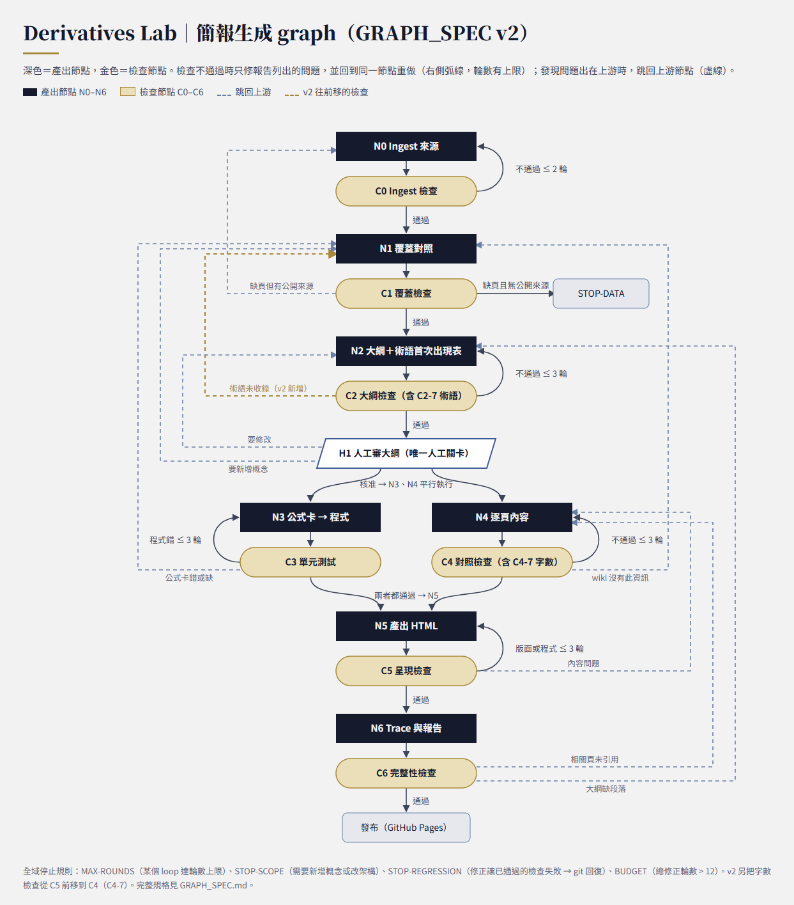

# Derivatives Lab｜波動率為什麼不是一個數字？

用一份 **LLM Wiki**（13 份公開來源整理成的知識庫）當作唯一的知識來源，經過一個有檢查、會回頭修正的 **graph 流程**，產生一份教學型 HTML 簡報。

**▶ 簡報：<https://itzel0115.github.io/derivatives-lab/slides/>**（鍵盤 ← → 換頁，`N` 開講者備註，`A` 開進階公式）



## 快速導覽

| 想看什麼 | 檔案 |
|---|---|
| 教學簡報（19 頁；5 種互動工具，用在 10 頁） | [slides/index.html](https://itzel0115.github.io/derivatives-lab/slides/)（線上版）；逐頁內容 [slides/slides.md](slides/slides.md)；大綱 [slides/outline.md](slides/outline.md) |
| LLM Wiki 入口 | [wiki/index.md](wiki/index.md)（13 個來源頁、27 個概念／商品／風險頁、17 張公式卡）；[術語表](wiki/glossary.md)（99 個術語）；[操作紀錄](wiki/log.md) |
| Wiki 怎麼寫、怎麼維護 | [AGENTS.md](AGENTS.md)（給 AI 看的規則） |
| loop／graph 的完整規格 | [GRAPH_SPEC.md](GRAPH_SPEC.md)（節點、通過條件、跳轉、停止規則）；流程圖 [docs/graph.png](docs/graph.png) |
| 每一頁投影片引用了哪些 wiki 頁、哪些來源 | [trace.md](trace.md) |
| 實際執行與檢查紀錄 | [runs/](runs/)：每次執行一個資料夾，每個檢查節點一份報告；commit 歷史就是執行紀錄 |
| v0／v1／v2 錯誤統計對照 | [runs/v2/comparison.md](runs/v2/comparison.md) |
| 和 AI 討論規則時問了什麼、我選了什麼 | [docs/agents-md-decisions.md](docs/agents-md-decisions.md) |
| 簡報視覺規格 | [style.md](style.md) |

## 主題

- **核心問題**：如果 Black-Scholes 是對的，同一標的所有選擇權反推出的波動率應該都一樣。為什麼市場上卻是一張彎曲的曲面？這張曲面又如何影響結構型商品？
- **目標讀者**：沒學過衍生性商品的大學生、一般投資人。
- **學習目標**：L1 看懂選擇權的 K、T 與損益圖 → L2 隱含波動率是從市價反推的 → L3 曲面為什麼不是平的 → L4 簡化 ELN 的票息從哪裡來、投資人承擔什麼風險。每一頁、每一題測驗都對應其中一個目標。

## LLM Wiki

照 Karpathy 的 LLM Wiki 三層架構：`raw/`（原始來源，不可改）→ `wiki/`（AI 維護）→ `AGENTS.md`（規則）。和原版不同、為了這份簡報加上的規則：

- **每條關鍵主張都有標籤與出處**：`[事實]`、`[範例]`、`[觀點]`、`[推導]`，附來源頁碼；事實與觀點另附一段原文短引，用來查翻譯有沒有失真。
- **不准憑記憶補內容**：來源沒寫就留空，列在頁尾「待補」。
- **來源衝突只並列、不裁決**：由我裁決前，簡報不得引用。
- **公式寫成公式卡（F01–F17）**：每張卡對到 `lab/` 裡的程式與單元測試。
- **著作權**：只有政府機關發布的文件（S6、S7）把原檔放進 git；其餘只留在本機，`raw/MANIFEST.md` 記錄網址與 SHA-256。
- **連結**：`wiki/index.md` 與 `trace.md` 用相對路徑連結，方便在 GitHub 上點；其他頁用 Obsidian 短連結。

來源（S1–S13）：OCC 選擇權特性與風險、Cboe VIX 方法論、Derman 的波動率微笑講義與論文、Derman & Kani、Gatheral & Jacquier（SVI）、OIC Greeks 教學、SEC 與 FINRA 投資人公告、Barclays 定價補充文件、《財訊》美超微報導、MIT OpenCourseWare 兩份講義。逐份資訊見 [wiki/index.md](wiki/index.md)。

**繼續新增資料**：請 AI 先讀 `AGENTS.md`，再依 §5 ingest 一份來源。流程是下載原檔 → 建立來源頁 → 更新概念頁、術語表、索引、紀錄 → 執行 C0 檢查 → 一份一個 commit。

## loop／graph 設計

流程圖如上，完整規格見 [GRAPH_SPEC.md](GRAPH_SPEC.md)。

- **主幹**：N0 ingest → N1 覆蓋對照 → N2 大綱 → H1 我審大綱 → N3 公式寫成程式、N4 逐頁內容（兩者平行）→ N5 產出 HTML → N6 追溯表與報告。
- **每個產出節點後面都有檢查節點（C0–C6）**：不通過時只修報告列出的問題，回到同一節點重做，輪數有上限（C0 2 輪，其餘 3 輪）。
- **問題出在上游時跳回上游**：例如 C4 發現 wiki 裡沒有某個資訊，就回 N1 補，而不是讓 AI 自己編。
- **停止規則**：資料不足、需要擴大範圍、修正造成回歸、總修正輪數超過 12，都會停下來交給我決定。
- **人工關卡只有 H1（審大綱）**：大綱是人最容易看出漏講、講錯的地方；逐頁內容和 HTML 交給自動檢查。

## 實際執行

| 執行 | 做法 | 結果 |
|---|---|---|
| v0 | 一句 prompt「用 wiki 做成教學簡報」，不跑 graph | 成品殘留 67 個錯誤（另有 15 個無對應類別） |
| v1 | 完整跑 graph | 過程中抓到並修正 25 個錯誤、修正 6 輪；最多的是 C4 抓到的術語未定義（13 個） |
| v2 | 把術語檢查往前移到 C2、字數檢查往前移到 C4 | C4 抓到的術語錯誤 13 → 1；修正 6 → 3 輪；沒有再發生回歸 |
| v2.1 | 只換視覺：先做多頁型樣本核准，再只重跑 N5 → C6 | C5、C6 第一輪通過 |

各次執行的報告：[runs/v1/check_report.md](runs/v1/check_report.md)、[runs/v2/check_report.md](runs/v2/check_report.md)、[runs/v2.1/check_report.md](runs/v2.1/check_report.md)。

## 資料夾

```
AGENTS.md  GRAPH_SPEC.md  style.md   規則
raw/                  原始來源（多數只留本機）與 MANIFEST.md
wiki/                 LLM Wiki：sources/ concepts/ products/ risks/ index.md log.md glossary.md
lab/                  互動工具的計算程式與單元測試（每個函式標註公式卡 ID）
slides/               outline.md → slides.md → index.html（assets/ 為樣式與互動程式）
runs/                 每次執行的檢查報告、截圖、檢查腳本
docs/                 決策紀錄、流程圖
style-samples/        視覺樣本
tools/                wiki 檢查腳本（引文比對、lint、公式數值預檢）
```

> 簡報內容是教學用的簡化說明，不構成投資建議。圖表中的曲面使用示意參數，不是市場資料。
